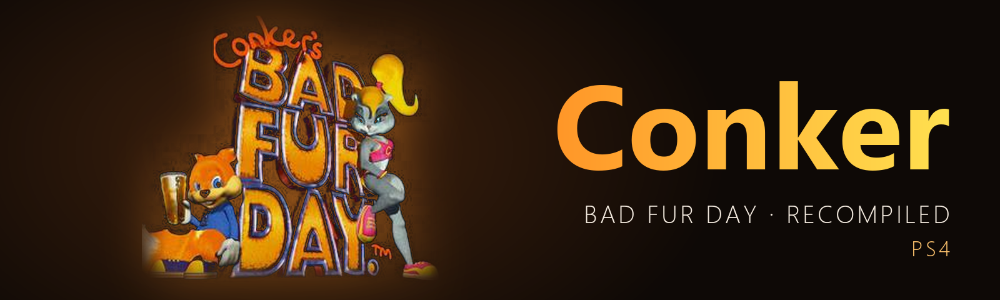

  

  
  
  
  
  

<h3 align="center">Conker's Bad Fur Day, recompiled to run natively on the PS4.</h3>

  <a href="https://github.com/iHaiDeeZ/Conker-PS4/releases/latest"><b>⬇ Latest version</b></a> ·
  <a href="#getting-started">Getting started</a> ·
  <a href="#controls">Controls</a> ·
  <a href="#status">Status</a> ·
  <a href="#faq">FAQ</a> ·
  <a href="https://discord.gg/fqjMs9gDJh">Discord</a> ·
  <a href="CREDITS.md">Credits</a>

---

## Overview

Conker for PS4 brings [CBFD-Recompiled](https://github.com/sciaschi/CBFD-Recompiled) to jailbroken
PS4 consoles as an app you launch from the home screen like any other. It isn't an emulator: the
game's N64 code has been statically recompiled with N64Recomp into native code, which runs on the
PS4's CPU on top of N64ModernRuntime. RT64 draws the game with **Vulkan** on the PS4's GPU, through
Mesa's RADV driver adapted to the PS4 (the same driver as Crema and HENkaku).

Start it, pick **Start Game** and play with a DualShock 4. Press **L3 + R3** during the game for a quick
menu with save states, graphics settings and controls.

**You bring your own ROM.** Nothing from the game is published here: no ROM, no recompiled code, no
packages. You build the package yourself from your own copy, and since it contains your game, it's
for your console only.

## Highlights

**The real game, natively**
- The whole game recompiled from the N64's MIPS code: no emulated CPU, so gameplay holds the game's own
  30 fps on the PS4.
- RT64's renderer on the PS4's GPU, with anti-aliasing and resolution options, and 60 fps by
  interpolation if you want it.

**A quick menu on L3 + R3**
- **Save states** in 9 slots, each with a card showing whether it's saved and when.
- Frame rate (30 original or 60 interpolated), anti-aliasing, resolution, volume and an FPS counter,
  applied and saved at once.
- **Controls** to remap the DualShock 4's buttons, **All Settings** for everything else, and Quit Game.

**The launcher you know**
- RecompFrontend's launcher with its Controls, Settings and Mods menus.
- The ROM is inside the package, so there's no Load ROM step: **Start Game** and you're in.

**Built for the PS4's hardware**
- The game's threads spread over all 7 cores; RT64's shader compiles run in the background so the
  game never waits for them.
- Compiled GPU pipelines are kept between runs, so later starts have fewer hitches.
- DualShock 4 rumble and light bar.
- Logs, a performance log, a freeze watchdog and a profiler you can switch on when something needs
  looking into.

## Getting started

**You need:** a jailbroken PS4 with **GoldHEN**, an FTP connection to it, the **US** ROM of Conker's
Bad Fur Day in `.z64` format (dumped from your own cartridge), and a Linux (or WSL) machine to build on.

1. Build the package from your ROM: follow [docs/DEVELOPMENT.md](docs/DEVELOPMENT.md#how-its-built).
   You get `out/Conker-vXX.YY.pkg`.
2. Install it with GoldHEN's **Package Installer** (title ID `CBFD00064`).
3. Start **Conker's Bad Fur Day: Recompiled** and pick **Start Game**.

On the first start the PS4 defaults are applied once: anti-aliasing off and the game's own 30 fps.
Both can be changed in the quick menu.

**Updating:** build and install the newer package on top of the old one. Saves and settings live in
`/data/Conker/` and survive updates.

## Controls

### In game

The DualShock 4 is set up as RecompFrontend's default controller (**OPTIONS** is Start). Every button
can be remapped: quick menu → **Controls**, or **Controls** in the launcher.

| Press | To |
|---|---|
| L3 + R3 | Open the quick menu (again, or Circle, to close it) |

### In the quick menu

| Press | To |
|---|---|
| Up / Down | Pick a row |
| Left / Right | Change a value, or pick a save state slot (1-9) |
| Cross | Do it (Resume, Save, Load, Controls, All Settings, Quit) |
| Circle / L3 + R3 | Close the menu |

The game keeps running behind the menu, but gets no input while it's open.

## Quick menu at a glance

| Row | What it does |
|---|---|
| Resume | Back to the game |
| Save State / Load State | Slot 1-9, with a card showing whether the slot is saved and when |
| Frame Rate | 30 (the game's own) or 60 (interpolated: every frame drawn twice, costs CPU) |
| Anti-Aliasing | Off or MSAA |
| Resolution | RT64's output resolution, up to full 1080p |
| Volume | Game volume |
| FPS Counter | On-screen frame rate |
| Performance Log / Profiler | Diagnostics, see [docs/DEVELOPMENT.md](docs/DEVELOPMENT.md#diagnostics) |
| Controls | The settings window opened on its Controls tab |
| All Settings | RecompFrontend's settings window |
| Quit Game | Back to the PS4 home screen |

## Your files

Everything the app creates sits in **`/data/Conker/`**:

- saves and RecompFrontend's settings
- the stored copy of the ROM (copied from the package on first start)
- `ps4.ini`: the port's own switches (performance log, profiler, one-time defaults)
- `pipelines.bin`: compiled GPU pipelines, kept between runs
- `conker.log`, `conker.prev.log`, `boot-trace.log`, `crash.log`, `freeze.log`: logs and freeze
  reports for bug reports

## Status

**v00.13, work in progress.** Tested on a launch-model PS4.

| Part | How it runs |
|---|---|
|  Gameplay | 30 fps (the game's own rate), long sessions without freezing |
|  Rain scenes, some cutscenes | 6-17 fps: RT64's renderer needs 70-100 ms of CPU per frame there |
|  Mods (`.nrm`) | Not tried on the PS4 yet |

What changed in each version is in the [releases](https://github.com/iHaiDeeZ/Conker-PS4/releases)
and the [commit history](https://github.com/iHaiDeeZ/Conker-PS4/commits/main).

## FAQ

**Why isn't there a package to download?**
The package contains the game itself (the recompiled code and the ROM it reads its data from), so it
can't be shared. Build it from your own ROM.

**Which ROM do I need?**
The US version of Conker's Bad Fur Day as a big-endian `.z64` file. The build checks it.

**Why is it slow in the rain?**
RT64 has much more to do there and the PS4's CPU can't keep up. Keep the Frame Rate at 30, and the
Performance Log and Profiler off. On a PS4 Pro, turn on **Boost Mode** in the PS4's settings.

**Can I use 60 fps?**
Yes: quick menu → Frame Rate → 60. RT64 then draws in-between frames, which costs CPU time, so busy
scenes get slower.

**How do I report a bug?**
On [Discord](https://discord.gg/fqjMs9gDJh) or in an [issue](https://github.com/iHaiDeeZ/Conker-PS4/issues).
Attach `conker.log`, `boot-trace.log` and, if there is one, `crash.log` or `freeze.log` from
`/data/Conker/`, and mention the version, what you were doing, your PS4 model and firmware.

## Good to know

- Save states work alongside the game's own saves; your saves stay in `/data/Conker/` across updates.
- The game keeps running while the quick menu is open (the runtime has no pause).
- Only the original PS4 has been tested so far. PS4 Pro reports are welcome.

## Community

Join the **[Discord](https://discord.gg/fqjMs9gDJh)** for help, reports and news.

## Thanks

- **[CBFD-Recompiled](https://github.com/sciaschi/CBFD-Recompiled)** by **Sean Ciaschi**: the
  recompilation this port builds, and the [Conker decompilation](https://github.com/mkst/conker) it
  started from
- **[N64Recomp](https://github.com/N64Recomp/N64Recomp)**, **[N64ModernRuntime](https://github.com/N64Recomp/N64ModernRuntime)**
  and **[RecompFrontend](https://github.com/N64Recomp/RecompFrontend)** by **Wiseguy** and contributors
- **[RT64](https://github.com/rt64/rt64)**: the renderer
- **[Mesa](https://mesa3d.org)**: the RADV Vulkan driver that draws every frame
- **[OpenOrbis](https://github.com/OpenOrbis)**: the PS4 toolchain

Everyone involved, with licences, is listed in **[CREDITS.md](CREDITS.md)**. How the port is built and
what it changes: **[docs/DEVELOPMENT.md](docs/DEVELOPMENT.md)**.

## License and disclaimer

The port's patches follow the licences of what they patch (MIT for CBFD-Recompiled, N64Recomp and
RT64; GPL-3.0 for N64ModernRuntime); see [CREDITS.md](CREDITS.md). The quick menu is adapted from
[Crema](https://github.com/iHaiDeeZ/Crema)'s in-game menu.

This is a fan-made project with no ties to Rare, Nintendo, Microsoft or Sony Interactive
Entertainment. Conker's Bad Fur Day is Rare's; Nintendo 64 is a trademark of Nintendo; PlayStation
and PS4 are trademarks of Sony Interactive Entertainment. Please only play games you own. This
project won't help you find or share game files.
